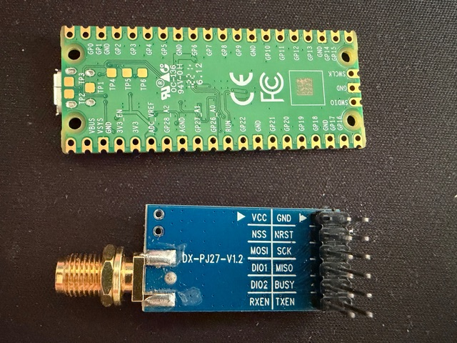
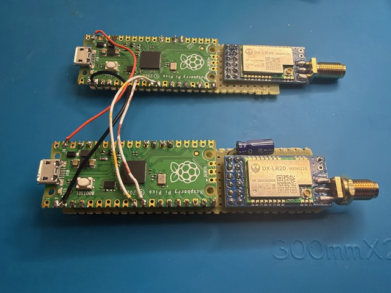
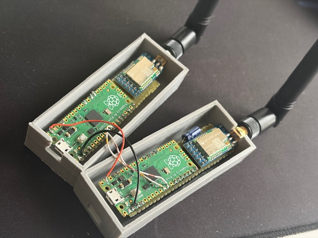
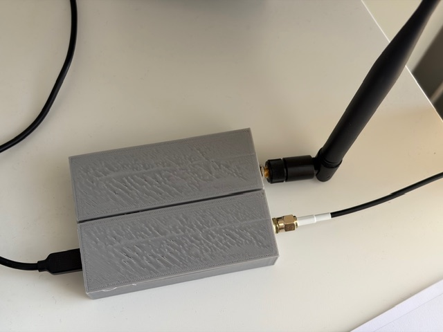

# Meshtastic UART MeshBridge (RP2040 + DX-LR20 / DX-LR30)


**A standalone hardware bridge between two Meshtastic networks using different radio presets.** Two Raspberry Pi Pico (RP2040) nodes are linked through **hardware UART1 (`Serial2`)** to exchange selected `MeshPacket` packets at the network layer. Original sender IDs are preserved, so nodes and channel messages from the remote network are visible with their real identity.

The bridge is designed to operate autonomously: it does not need MQTT, an Internet connection or a permanently connected host computer to forward traffic. The Master board can additionally connect over USB to a Raspberry Pi for monitoring and bot services.

> **Hardware build guide:** the detailed assembly of the RP2040 + DX-LR radio node, including module modifications and Meshtastic variant files, is documented in the companion repository: [rp2040-LLCC68-meshtastic](https://github.com/jsuescun/rp2040-LLCC68-meshtastic). This repository focuses on the UART bridge firmware, inter-node link and network packet forwarding.

---

## Contents

1. [Motivation](#1-motivation)
2. [Goals](#2-goals)
3. [Repository layout](#3-repository-layout)
4. [Hardware](#4-hardware)
5. [How it works](#5-how-it-works)
6. [Building and installing](#6-building-and-installing)
7. [Node configuration](#7-node-configuration)
8. [Frequency calibration](#8-frequency-calibration)
9. [Verifying operation](#9-verifying-operation)
10. [Troubleshooting](#10-troubleshooting)
11. [Known limitations](#11-known-limitations)
12. [Optional: RAM-only NodeDB](#12-optional-ram-only-nodedb)
13. [License](#13-license)

---

## 1. Motivation

When a regional mesh migrates between radio presets — for example from **MediumFast** to a narrowband custom preset such as **SFNarrow** — it splits into two RF islands:

* **Physical incompatibility.** Different bandwidth, spreading factor and frequency slot mean nodes on one preset cannot hear or relay packets from the other.
* **Limits of host-based bridges.** Bridges built on the Python/Serial API work at the application layer: forwarded messages appear to come from the gateway node rather than the original sender, node discovery and traceroutes do not cross, and a host computer must stay online running scripts.
* **Airtime asymmetry.** The narrowband preset carries fewer bytes per second. Repeating everything from a busy MediumFast mesh (telemetry, positions, private traffic) would waste its airtime and push it towards the EU868 duty-cycle limit.

## 2. Goals

1. **Autonomous bridging.** Two RP2040 boards wired UART-to-UART. No MQTT, internet or host computer required for forwarding.
2. **Transparent forwarding.** The original `from`, `to`, packet `id` and `hop_start` are preserved, so remote nodes appear with their real identity and names.
3. **Airtime protection.** Only channel chat, node discovery and the traffic needed for traceroutes cross. Telemetry, positions and anything the bridge cannot decrypt are dropped.
4. **Safe channel mapping.** Channels are matched **by name, not by index**, so a misconfigured channel list can never re-encrypt a message into the wrong channel.
5. **Single host interface.** The Master board connects over USB to a Raspberry Pi running monitoring and bot software.
6. **Invisible bridge.** The bridge boards never forward their own packets, so each network sees exactly one bridge node: its local board. Both boards may share the same name.

---

## 3. Repository layout

```text
.
├── README.md
├── LICENSE
├── firmware/
│   └── src/modules/
│       ├── BridgeModule.h          # the bridge (behind #ifdef HAS_UART_BRIDGE)
│       └── BridgeModule.cpp
└── hardware/
```

The Meshtastic variant files (`variant.h`, `platformio.ini`) and the detailed RP2040 + DX-LR node assembly guide are maintained in the companion [rp2040-LLCC68-meshtastic repository](https://github.com/jsuescun/rp2040-LLCC68-meshtastic).

---

## 4. Hardware

### Roles

| Role | Network | Board | Radio | Notes |
| :--- | :--- | :--- | :--- | :--- |
| **Master** | `SFNarrow` (SF7 / 62.5 kHz / CR 4/5) | Raspberry Pi Pico | **DX-LR30** (`SX1262`) | USB to host Raspberry Pi for monitoring and bot |
| **Slave** | `MediumFast` (SF9 / 250 kHz) | Raspberry Pi Pico | **DX-LR20** (`LLCC68`) | Headless, powered from the Master |

Each board runs its own build: `USE_SX1262` for the Master, `USE_LLCC68` for the Slave. The LLCC68 supports SF5–SF9 at 125 kHz, up to SF10 at 250 kHz and up to SF11 at 500 kHz, so MediumFast is within range.

### Hardware assembly gallery

The following photos document the build in four stages. The detailed assembly of each RP2040 + DX-LR radio node (module mounting, modifications and firmware variant) is covered in the companion [rp2040-LLCC68-meshtastic repository](https://github.com/jsuescun/rp2040-LLCC68-meshtastic).

**1. RP2040 board and DX-LR radio module**



*Identification of the main components used to build each Meshtastic node.*

**2. Assembled nodes and UART interconnection**



*The Master and Slave nodes, with crossed TX/RX signals and a common ground.*

**3. Electronics installed in the 3D-printed enclosure**



*The two-node assembly fitted into its printed enclosure.*

**4. Complete MeshBridge installation**



*Final bridge installation, showing the completed hardware assembly.*

### Board-to-board wiring

| Master Pico | Slave Pico | Signal | Notes |
| :--- | :--- | :--- | :--- |
| Pin 39 (`VSYS`) | Pin 39 (`VSYS`) | Power | **Never tie the `3V3` pins together.** Each Pico keeps its own regulator. Add a **100 µF** capacitor between `VSYS` and `GND` on the Slave. |
| Pin 38 (`GND`) | Pin 38 (`GND`) | Ground | Shared reference for power and UART. |
| Pin 11 (`GP8`) | Pin 12 (`GP9`) | UART1 TX → RX | Crossed link, 460800 bps 8N1, 3.3 V logic. |
| Pin 12 (`GP9`) | Pin 11 (`GP8`) | UART1 RX ← TX | |

**Wiring notes**

* **Keep the UART wires short.** For a few centimetres inside one enclosure, plain wires are fine. For runs over about 20–30 cm, twist **each signal with a ground** (TX+GND, RX+GND), not TX with RX.
* **Optional series resistors.** A 100–330 Ω resistor in series with each TX, close to the pin, damps ringing and protects the pins.
* **Keep the UART wiring away from the antennas and coax.**
* **Never power only one board with the UART connected.** The powered board's TX would back-feed the unpowered Pico through its GP9 protection diodes. With the shared `VSYS` above, both boards always power up together.
* **Optional pull-up on RX.** If a board may run with the UART disconnected, a pull-up keeps GP9 from picking up noise. Add this right after `Serial2.begin()` in the `BridgeModule` constructor; it is harmless when connected:
  ```cpp
  gpio_pull_up(PIN_SERIAL2_RX);
  ```

### Antenna placement and spectrum

The default MediumFast channel in EU_868 (250 kHz centred on 869.525 MHz) covers the whole 869.40–869.65 MHz sub-band, where SFNarrow also operates. LoRa with different SF and bandwidth coexists reasonably well over the air. However, with both radios a few centimetres apart, each one is effectively deaf while the other transmits at 22 dBm. **Separate the two antennas as much as practical**; a couple of metres of coax already helps a lot. If your MediumFast network uses a frequency outside this sub-band, this does not apply.

### LoRa radio wiring (SPI1, identical on both boards)

| Pico pin | GPIO | Radio pin | Function |
| :--- | :--- | :--- | :--- |
| 14 | `GP10` | `SCK` | SPI1 clock |
| 15 | `GP11` | `MOSI` | SPI1 MOSI |
| 16 | `GP12` | `MISO` | SPI1 MISO |
| 5 | `GP3` | `NSS` | Chip select |
| 4 | `GP2` | `BUSY` | Radio busy |
| 20 | `GP15` | `RST` | Radio reset |
| 26 | `GP20` | `DIO1` | IRQ |
| 27 | `GP21` | `RXEN` | RF switch RX enable |
| 29 | `GP22` | `TXEN` | RF switch TX enable |
| 36 | `3V3` | `VCC` | 3.3 V (add 100 µF + 100 nF decoupling) |
| 38 | `GND` | `GND` | Ground |

`DIO2` stays unconnected so the firmware drives `TXEN`/`RXEN` explicitly. `DIO3` powers the module's 1.8 V TCXO (`SX126X_DIO3_TCXO_VOLTAGE 1.8`).

---

## 5. How it works

`BridgeModule` is a `MeshModule` (promiscuous, so it sees channel traffic addressed to other nodes) and an `OSThread` that polls the UART every 10 ms.

### What crosses the bridge

Only packets the bridge board has **decrypted with a channel key it holds** are considered. Packets it cannot decrypt (unknown channels, PKI direct messages) never reach the module. Packets originated by the bridge boards themselves never cross.

| Port | Broadcast | Unicast |
| :--- | :--- | :--- |
| `TEXT_MESSAGE_APP` (1) | ✅ Channel messages | ❌ No DMs |
| `NODEINFO_APP` (4) | ✅ Node discovery | ✅ Only if the rule below allows it |
| `TRACEROUTE_APP` (70) | — | ✅ Only if the rule below allows it |
| `ROUTING_APP` (5) | ❌ | ✅ Only ACK/NAK replies to something that crossed |
| Everything else (telemetry, position, Store & Forward…) | ❌ | ❌ |

**Unicast rule.** A *request* crosses only if its destination is known to live on the other side; each board learns this from the nodes whose packets arrive over the UART (64-entry table). A *reply* crosses only if its `request_id` matches a request that previously crossed (128-entry `{from, id}` cache). This keeps traceroutes between two nodes of the same network from wasting airtime on the other.

### Channel mapping by name

Every UART frame carries the name of the channel the packet arrived on. The receiving board looks up its own matching channel:

* **Primary ↔ primary**, regardless of name. The primary channel of each network usually has a different name, and this maps them onto each other.
* **Secondary ↔ secondary** with exactly the same name (case-sensitive). Secondaries with an empty name are not bridged.

If no matching channel exists, the packet is dropped and a warning is logged. Otherwise it is re-encrypted with the local key of the matched channel and transmitted on the local preset.

### Loop and hop protection

* The `{from, id}` cache prevents a packet from crossing twice or bouncing back.
* `hop_limit` is decremented when crossing, so the bridge counts as one hop. Packets arriving with `hop_limit == 0` are not bridged.
* On injection, side-specific routing metadata (`next_hop`, `relay_node`, RX SNR/RSSI/time) is cleared so the packet floods normally in the new network. `want_ack` is cleared on broadcasts, since the sender already received its implicit ACK on its own side. Unicasts keep `want_ack`, so the injecting board behaves like a normal relay: it retries a few seconds later if nobody relays the packet, and stops as soon as it hears it relayed.

### UART frame

```text
+------+------+-------+-------+----------------------+----------------------+-------+-------+
| 0xAA | 0x55 | LEN_H | LEN_L | Bridge header (18 B) | Protobuf MeshPacket  | CRC_H | CRC_L |
+------+------+-------+-------+----------------------+----------------------+-------+-------+
                               | ver | flags | peer nodeNum (4, BE) | channel name (12) |
```

* `LEN` (big-endian) covers header + protobuf, up to 510 bytes.
* `flags` bit 0 marks the primary channel.
* `CRC` is CRC16-CCITT (poly `0x1021`, init `0xFFFF`) over header + protobuf.
* The receiver resynchronises after 50 ms of silence mid-frame.

---

## 6. Building and installing

Built against stable **Meshtastic firmware `v2.7.26`**, with unused subsystems stripped (Bluetooth, WiFi, screen, input, I2C, accelerometer, GPS, MQTT, PAXcounter, environmental/air-quality/power telemetry, detection sensor, audio, canned messages) to save RP2040 RAM and flash.

### 1. Get the firmware

```bash
git clone --depth 1 --branch v2.7.26.54e0d8d --recurse-submodules --shallow-submodules \
  https://github.com/meshtastic/firmware.git
cd firmware
```

### 2. Add the variants

Copy the Master (SX1262) and Slave (LLCC68) variants from the hardware repository into `variants/rp2040/`. Each variant's `platformio.ini` must include:

```ini
build_flags =
  ${rp2040_base.build_flags}
  -D HAS_UART_BRIDGE=1
  -D MAX_NUM_NODES=10
```

`MAX_NUM_NODES` is a compile-time value. Ten entries is a deliberate choice; see [Node configuration](#7-node-configuration).

### 3. Add the module

Copy `firmware/src/modules/BridgeModule.h` and `BridgeModule.cpp` into `src/modules/`. Then, in `src/modules/Modules.cpp`, add with the other includes:

```cpp
#ifdef HAS_UART_BRIDGE
#include "modules/BridgeModule.h"
#endif
```

And at the end of `setupModules()`:

```cpp
#ifdef HAS_UART_BRIDGE
    bridgeModule = new BridgeModule();
#endif
```

No other firmware files are modified.

### 4. Compile and flash

```bash
pio run -e <master_env>   # SX1262 build for the Master
pio run -e <slave_env>    # LLCC68 build for the Slave
```

Flash each `.uf2` by holding BOOTSEL while connecting the Pico and copying the file to the `RPI-RP2` drive.

---

## 7. Node configuration

* **Channels.** Each board needs the primary channel of its own network plus every secondary channel to be bridged, using the **same name** on both boards. Channels present on only one board are not bridged.
* **Serial module.** The official `SerialModule` must stay disabled (`serial.enabled = false`), since `BridgeModule` owns UART1.
* **Hop limit.** The bridge consumes one hop, so users far from the bridge may need a hop limit one higher than usual to reach the other network.
* **Node names.** Both bridge boards may share the same long name, since each network only ever sees its own board. Different short names help when debugging.
* **Remote administration.** Add the administrator's public key to `security.admin_key` on each board. Each board can only be administered from its own network or over USB, because PKI admin packets do not cross the bridge.

### Why `MAX_NUM_NODES=10`

The bridge does not use the NodeDB: forwarding, filtering and channel mapping rely on the module's own caches. The bot on the host keeps its own node and message database. The NodeDB only matters for the bridge board's own identity and for remote administration.

With more than 200 active nodes in range, any table smaller than the number of nodes heard keeps evicting entries. A table of 80 would evict almost as often as one of 10, while using more RAM and writing a larger `nodes.proto` each time. The firmware already rate-limits these writes (`Defer NodeDB saveToDisk for now`), and only a NodeInfo with new data (`changed=1`) triggers one. A small table keeps each write short. To remove these writes entirely, see [Optional: RAM-only NodeDB](#12-optional-ram-only-nodedb).

---

## 8. Frequency calibration

Each board should be aligned with the actual frequency of its network. Narrowband presets have little margin: at 62.5 kHz, LoRa tolerates roughly ±15 kHz of offset in total. A board several kHz off still decodes, but it wastes part of that margin and loses packets more easily with temperature drift.

The radio driver reports the measured offset of every received packet:

```text
DEBUG | 13 [RadioIf] Corrected frequency offset: -7699.624512
```

If **all** transmitters show roughly the same value, the difference is systematic: either this board's reference or the frequency the network is actually tuned to. In either case, the fix is to apply that offset to the board.

### ⚠️ Units: the value is in MHz

`lora.frequency_offset` is **added to the frequency in MHz**. The web client labels the field "Hz", which is misleading. Entering `-7500` there shifts the radio by 7500 **MHz**. The radio keeps running until the periodic AGC reset tries to recalibrate at an impossible frequency, and then the firmware stops on an assertion:

```text
DEBUG | 60 SX126x AGC reset: warm sleep + Calibrate(0x7F)
DEBUG | 60 SX126x standby RadioLib err=-707
assertion "err == RADIOLIB_ERR_NONE" ...
```

Set the offset with the CLI, in MHz.

### Procedure

Close the web client and stop the bot first: only one program can open the serial port. The commands below assume `/dev/ttyACM0`.

**1. Check the current configuration.** `frequency_offset` should be `0` before measuring.

```bash
meshtastic --port /dev/ttyACM0 --get lora
```

**2. Record offsets for a few minutes.** Aim for 20–30 readings, then stop with `Ctrl+C`.

```bash
meshtastic --port /dev/ttyACM0 --noproto | grep "Corrected frequency offset" | tee freq.log
```

**3. Compute the mean.**

```bash
awk '{s+=$NF; n++} END {printf "n=%d  mean=%.0f Hz\n", n, s/n}' freq.log
```

**4. Apply the correction**, in MHz. Start with the **opposite** sign of the measured mean. For example, a mean of −7650 Hz gives:

```bash
meshtastic --port /dev/ttyACM0 --set lora.frequency_offset 0.0076
```

The board reboots.

**5. Verify.**

```bash
meshtastic --port /dev/ttyACM0 --noproto | grep -E "AGC reset|standby|assert|Corrected"
```

* The readings should now be within a few hundred Hz of zero.
* If they moved towards **twice** the original value instead, the sign was wrong: set the same value with the other sign.
* Each `AGC reset` line, roughly every 60 s, must not be followed by `standby … err` or `assert`. Let at least four or five pass.

**Reference result (Master, SFNarrow):** a mean offset of −7.65 kHz before calibration; with `frequency_offset = 0.0076`, the readings fell to between −320 and +120 Hz. Repeat the procedure on the Slave; its TCXO is a different part and has its own error.

**To undo:**

```bash
meshtastic --port /dev/ttyACM0 --set lora.frequency_offset 0
```

If a wrong value has left the board hanging, reconnect it and send this command right after boot, before the first AGC reset at about 60 s.

### Monitoring tips

* Piping the CLI's output through several commands can hold it back in buffers. The simplest approach is the one above: one `grep`, saved to a file, and the analysis afterwards.
* On Debian / Raspberry Pi OS, `awk` is `mawk`, which buffers its input. For live processing, use `awk -W interactive`.

---

## 9. Verifying operation

### Boot checks

On each board, the boot log should contain:

| Line | Meaning |
| :--- | :--- |
| `SX1262 init success, TCXO, Vref 1.800000V` (Master) or `LLCC68 init success` (Slave) | Radio and TCXO initialised |
| `Set radio: region=EU_868, name=SFNarrow …` / `Frequency set to …` | Preset and frequency, including any offset |
| `BridgeModule: UART1 TX=8 RX=9 a 460800 bps` | Bridge started |

### Reading the log

Packets arriving over the UART are injected from the bridge's own thread, so the router lines they generate are tagged **`[BridgeModule]`** instead of `[Router]`. That tag is the simplest proof that the link works.

Record the log to a file and search it afterwards:

```bash
meshtastic --port /dev/ttyACM0 --noproto | tee -a bridge.log
```

```bash
grep -a "\[BridgeModule\]" bridge.log      # everything that arrived through the bridge
grep -a "BridgeModule:" bridge.log         # bridge warnings (CRC, resync, missing channel)
grep -a -i "4066daa5" bridge.log           # everything about one node (8 hex digits of its ID)
```

Forwarding towards the UART is not logged by default. For a full trace on both boards, add these two lines and rebuild. In `sendOverUart()`, after the `Serial2.write` calls:

```cpp
LOG_DEBUG("BridgeModule: -> UART id=0x%08x fr=0x%08x port=%u canal=%u len=%u", out.id, out.from,
          (unsigned)out.decoded.portnum, (unsigned)mp.channel, (unsigned)len);
```

In `processFrame()`, before `router->sendLocal(p)`:

```cpp
LOG_DEBUG("BridgeModule: <- UART id=0x%08x fr=0x%08x port=%u -> canal local %d", p->id, p->from,
          (unsigned)p->decoded.portnum, ch);
```

### Functional tests

1. **Node discovery.** Nodes from the other network appear in the apps, with their real names.
2. **Channel messages.** A message on each network's primary channel appears on the other network under the original sender's name. Repeat in the other direction, and on every shared secondary channel.
3. **Missing channel.** Rename a secondary channel on one board only. The log must show `el canal '…' no existe en esta placa` and the message must not cross.
4. **Traceroute.** From a node on one network to a node on the other, once that node's NodeInfo has crossed. A reply must come back.
5. **Filtering.** Telemetry and positions from either side must never appear in a `[BridgeModule]` line.
6. **Link robustness.** Disconnect and reconnect a UART wire during traffic. CRC or resync warnings may appear, and forwarding must resume on its own.
7. **Stability.** After several hours, this must return nothing:
   ```bash
   grep -a -E "standby.*err|assert" bridge.log
   ```

### Reference trace: traceroute across the bridge (Master log)

```text
557 [Router]       Lora RX (id=0x07c593d0 fr=0x25a3bb33 to=0x341a3ad8 ... Portnum=70 WANTRESP)    <- request from SFNarrow
558 [BridgeModule] localSend to channel 0                                                       <- reply arrives over UART
558 [BridgeModule] Setting next hop for packet with dest 25a3bb33 to 0
558 [BridgeModule] enqueue for send (id=0xc6a89320 fr=0x341a3ad8 to=0x25a3bb33 ... HopLim=2 hopStart=3 relay=0x23)
564 [Router]       Sending retransmission fr=0x341a3ad8,to=0x25a3bb33,id=0xc6a89320, tries left=2
565 [RadioIf]      Lora RX (id=0xc6a89320 ... relay=0x1a)                                       <- relayed by a neighbour
565 [Router]       cancelSending id=0xc6a89320                                                  <- implicit ACK, no more retries
```

The reply took 1.3 s to come back from the MediumFast side. Its `request_id` matches the original request, `hop_limit` dropped by one when crossing, `next_hop` was cleared, and the single retry stopped as soon as a neighbour relayed the packet.

---

## 10. Troubleshooting

| Symptom | Cause / action |
| :--- | :--- |
| Firmware stops with `standby RadioLib err=-707` and `assertion "err == RADIOLIB_ERR_NONE"` after `AGC reset` | Invalid `frequency_offset`, usually entered in Hz instead of MHz. Set it to `0` and redo the [calibration](#8-frequency-calibration). |
| No `[BridgeModule]` lines and no warnings | TX/RX not crossed, or missing common GND. Check that each `GP8` goes to the other board's `GP9`. |
| `trama UART descartada por CRC` / `trama UART incompleta` | Noise or wiring. Shorten or twist the wires with GND, move them away from the antennas. If it persists, lower `BRIDGE_BAUD` to 115200. |
| `el canal '…' no existe en esta placa` | The link works, but the secondary channel names differ between boards. |
| Remote nodes visible, but DMs to them fail | Expected: PKI direct messages do not cross. |
| `ToPhone queue is full, drop packet` | No API client is reading the Master's queue, for example while monitoring with `--noproto`. It does not affect the mesh. The queue drains once the bot connects. |
| `Ignore received packet due to error=-7` | CRC error on a weak packet (typically SNR below −8 dB). Normal near the sensitivity limit. |
| `Node database full with 10 nodes … Erasing oldest entry` | Expected with `MAX_NUM_NODES=10`. See [Why `MAX_NUM_NODES=10`](#why-max_num_nodes10). |
| Garbage characters mixed with the log | Binary API frames from a client on the same port. Close other clients when reading logs. |

---

## 11. Known limitations

* **No direct messages across networks.** PKI DMs cannot be decrypted by the bridge and are not forwarded. Users will see remote nodes, and DMs sent to them will fail.
* **No cross-network remote administration.** Each bridge board can be administered only from its own network, or over USB for the Master.
* **Traceroute display.** Routes crossing the bridge may show a bridge board as an unnamed node (`!xxxxxxxx`) or an unknown hop, since the bridge boards' NodeInfo does not cross. This is cosmetic.
* **Remote-node table after reboot.** It starts empty. Unicast requests to remote nodes do not cross until some packet from those nodes, such as their periodic NodeInfo, has come through the bridge again.
* **Bridge boards' own traffic.** Messages sent by a bot through the Master stay in the Master's network.
* **AGC reset in 2.7.x.** Firmware 2.7.26 resets the SX126x AGC every 60 s and stops on an assertion if that sequence fails. Upstream reworked this in the 2.8 series, which resets only when the radio has been quiet and bounds the BUSY wait. With a valid configuration, it has been stable in testing on 2.7.26.

---

## 12. Optional: RAM-only NodeDB

Since neither the bridge nor the host bot depends on the stored NodeDB, its persistence to flash can be disabled. The table keeps working in RAM, but is never written to `/prefs/nodes.proto`. This removes the periodic flash writes caused by node churn.

**Consequences**

* The node list starts empty after every reboot and refills from traffic.
* **Favorites are stored in `nodes.proto` and are lost on reboot.** Check that remote administration still works for you without a persisted entry for the admin node. The admin authorisation (`security.admin_key`) is kept in `config.proto` and is not affected.
* `config.proto`, `channels.proto`, `module.proto` and `device.proto` are still saved normally.

### Patch

Locate the function that writes the node database in your firmware tree:

```bash
grep -n "nodes.proto\|saveNodeDatabaseToDisk\|SEGMENT_NODEDATABASE" src/mesh/NodeDB.cpp src/mesh/NodeDB.h
```

In 2.7.x it is `NodeDB::saveNodeDatabaseToDisk()`. The `Save to disk 16` log line corresponds to the node-database segment. Make it return early on bridge builds:

```cpp
bool NodeDB::saveNodeDatabaseToDisk()
{
#ifdef HAS_UART_BRIDGE
    // Bridge builds keep the NodeDB in RAM only: no flash writes from node churn.
    return true;
#endif
    // ... original body unchanged ...
}
```

If the function has a different name or signature in your tree, apply the same early return to whichever function writes `/prefs/nodes.proto`.

After flashing, the existing `nodes.proto` stays on flash with its last contents and is loaded at boot. It is never updated again. To start clean, clear it once:

```bash
meshtastic --port /dev/ttyACM0 --reset-nodedb
```

**Check:** after an hour of operation, this should return `0`:

```bash
grep -a -c "Save /prefs/nodes.proto" bridge.log
```

---

## 13. License

This module is built on the Meshtastic firmware and is distributed under the same license as the firmware (GPL-3.0).
